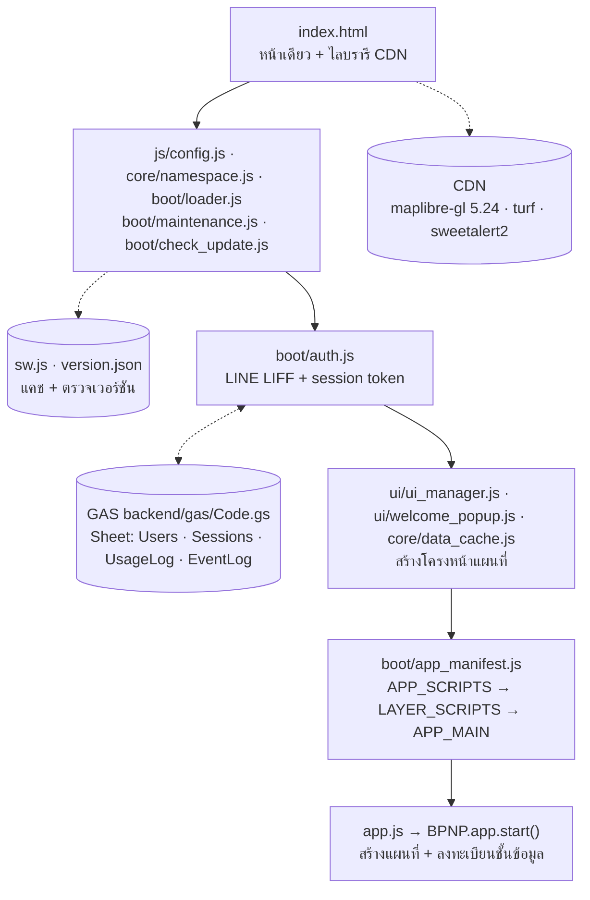
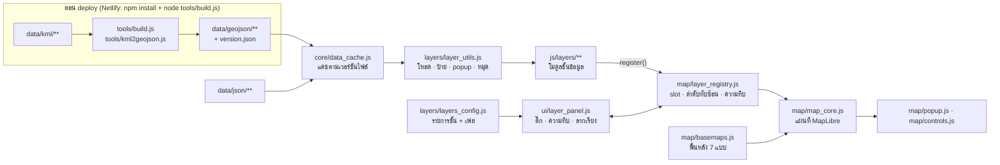
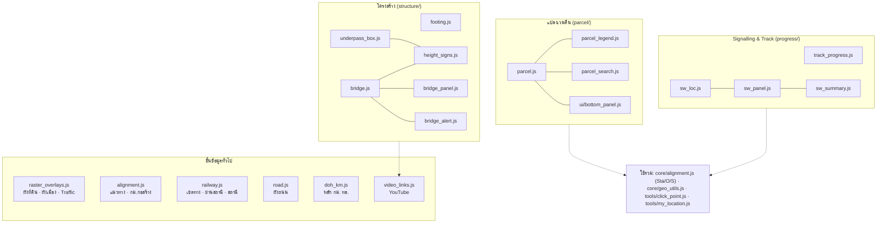
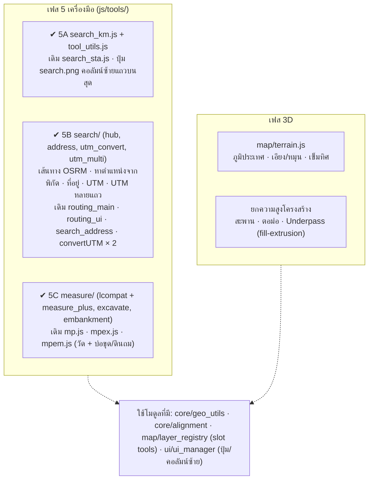

# BPNP Map 3D — ผังการทำงานและความเชื่อมโยงของไฟล์

> สถานะ: v3.7.00 · ชั้นข้อมูลครบทุกชั้น (เฟส 0–4) · เครื่องมือครบ (เฟส 5) · งานที่เหลือ: เฟส 3D
> แผนภาพด้านล่างเป็น Mermaid — GitHub วาดให้อัตโนมัติเมื่อเปิดไฟล์นี้บนเว็บ

---

## 1. ลำดับการเริ่มแอป

- `APP_SCRIPTS` (ขาดไม่ได้): core, map, ui/layer_panel, ui/about_popup, tools/my_location, tools/click_point
- `LAYER_SCRIPTS` (ขาดได้ — ไฟล์หายแอปยังเปิด ชั้นนั้นขึ้น "ไม่พร้อมใช้งาน" + บันทึก `App Warning`)
- `auth.js` แบ่งขั้นตอนการเปิดแอป ถ้าล้มเหลวแสดงขั้น + รายละเอียด และบันทึก `App Error` ลง EventLog

---

## 2. แกนแผนที่และเส้นทางข้อมูล

ตัวแปลง (`tools/kml2geojson.js`) ทำให้ข้อมูลจาก CAD แสดงเหมือน Leaflet:
พื้นแบบ even-odd ด้วย XOR · เส้นขอบเดิมเก็บแยก (`_outline`) · เส้น 2–3 จุด · ตัดเศษบาง < 5 ซม. · จัดทิศทาง ring (รายละเอียด MIGRATION_GUIDE หัวข้อ 15, 20, 27, 29)

---

## 3. โมดูลชั้นข้อมูล

| ไฟล์ | หน้าที่ | ข้อมูลที่ใช้ | ต้นฉบับ Leaflet |
|---|---|---|---|
| `layers/raster_overlays.js` | ผังที่ดิน กรมที่ดิน, ผังเมือง DPT, TomTom Traffic | tile/WMS ภายนอก | main.js |
| `layers/alignment.js` | Alignment Track, กม.ก่อสร้าง + แผงขนาดตัวเลข | `kml/alignment/al_track`, `sta_1km` | main.js |
| `layers/railway.js` | เขตทาง, ย่านสถานี, รายชื่อสถานี (HTML marker) | `kml/railway/*` | main.js |
| `layers/road.js` | ผังถนน Service/Access | `kml/road/*` | main.js |
| `layers/doh_km.js` | หลัก กม. กรมทางหลวง + ปุ่ม กม. ทล. | `json/doh_km_post.json` | DOH_ShowKM.js |
| `layers/video_links.js` | ลิงก์ YouTube สถานี/โครงสร้าง | `json/video_links.json`, `box_timestamp.json` | openYoutubeByKM_box.js |
| `layers/parcel/parcel.js` | แปลงเวนคืน + Pay Out, popup + รูป | `kml/parcel/*`, `assets/parcels/` | setPatternLegend*.js, setPopup.js |
| `layers/parcel/parcel_legend.js` | legend ข้อมูลพื้นที่เวนคืน | — | setPatternLegend.js |
| `layers/parcel/parcel_search.js` | ค้นหารหัสแปลง (มุมขวาบน) | — | leaflet-search.js |
| `ui/bottom_panel.js` | ตารางรายการแปลง | — | bottomPanel.js |
| `layers/structure/footing.js` | Footing VB45–VB118 + Pier | `kml/footing/*` | main.js |
| `layers/structure/underpass_box.js` | Underpass + Box Culvert + legend | `kml/structure/underpass`, `box_culvert` | main.js, setUnderpassLegend.js |
| `layers/structure/height_signs.js` | ป้ายความสูง (กลุ่ม underpass, bridge, field) + กล่องอธิบาย | `json/height_signs.json` (กลุ่ม field) | HeightSignManager.js, HeightSignAlert.js, mark_Sign.js |
| `layers/structure/bridge.js` | สะพานเหล็ก/คอนกรีต/Overpass + การ์ดความคืบหน้า | `kml/structure/bridge_sb`, `bridge_cb`, `overpass`, `json/bridge_progress.json` | BridgeLayerManager3.js |
| `layers/structure/bridge_panel.js` | ตารางความก้าวหน้างานสะพาน | — | BridgeBottomPanel.js |
| `layers/structure/bridge_alert.js` | แจ้งเตือนงานล่าช้า | — | Critical_Alert_Str.js |
| `layers/progress/track_progress.js` | กราฟความคืบหน้างานวางราง | `json/km_data.json`, `track_progress.json` | tw_ProgressManager.js, tw_progress.js |
| `layers/progress/sw_loc.js` | ตู้ LOC 216 ตู้ | `json/sw_loc.json` | sw_loc_manager.js |
| `layers/progress/sw_panel.js` · `sw_summary.js` | ตาราง + แผงสรุป SW-LOC | — | sw_LocBottomPanel.js, sw_summary_panel.js |
| `tools/tool_utils.js` | ตัวช่วยร่วมของเครื่องมือ (หมุด, บิน, ซูมพอดี, วงกระเพื่อม, popup, ดาวน์โหลด, กันคลิกทะลุ) | — | (แทนคำสั่ง Leaflet) |
| `tools/search_km.js` | ค้นหา กม. + หมุด + วงกระเพื่อม | alignment 20 ม. | search_sta.js |
| `tools/search/hub.js` | แผงค้นหา/พิกัด 5 โหมด + เส้นทาง OSRM + ที่อยู่จากพิกัด | OSRM, Longdo | routing_main.js, routing_ui.js |
| `tools/search/address.js` | ค้นหาพิกัดจากที่อยู่ | kongvut/thai-province-data, Longdo | search_address.js |
| `tools/search/utm_convert.js` | แปลง UTM ↔ Lat/Lng ทีละจุด | core/geo_utils | convertUTM.js |
| `tools/search/utm_multi.js` | แปลงหลายแถว + วางจาก Excel + หมุดเลขแถว | core/geo_utils | convertUTM_MultiRow.js |
| `tools/measure/lcompat.js` | Leaflet ชุดย่อยบน MapLibre (เฉพาะเครื่องมือวัด ไม่ประกาศ window.L) | — | (ใหม่) |
| `tools/measure/measure_plus.js` | วัดระยะ/พื้นที่/วงกลม, นำเข้า/ส่งออก, ปรับพื้นที่ | turf | mp.js (คัดลอกตรง) |
| `tools/measure/excavate.js` · `embankment.js` | ปริมาตรบ่อขุด / ดินถม หลายชั้น + รูปตัด | turf | mpex.js, mpem.js (คัดลอกตรง) |
| `tools/measure/index.js` | สร้างเครื่องมือวัด + ปุ่ม + สถานะ busy | — | main.js |

---

## 4. งานที่เหลือ

**เก็บตก 4A — เสร็จใน v3.4.01:** ป้ายความสูงภาคสนามจาก `mark_Sign.js` (`SignLayerManager`) ย้ายเป็นกลุ่ม `field` ใน `height_signs.js` ลงทะเบียนใน `bridge.js` · ตำแหน่งจาก `core/alignment.js → pointAt(sta, offset)` · ปุ่ม "ป้าย" ของ Bridge เปิดทั้งกลุ่ม `bridge` และ `field`

---

## 5. กติกาที่ต้องยึดเมื่อเพิ่ม/แก้ไฟล์

| เรื่อง | กติกา | อ้างอิง |
|---|---|---|
| ลงทะเบียนชั้น | ผ่าน `BPNP.layers.utils.register({ register(map) })` และ `BPNP.map.registry.register()` เท่านั้น | MIGRATION_GUIDE 9.2 |
| โหลดสคริปต์ | ชั้นข้อมูลใหม่ใส่ใน `LAYER_SCRIPTS` (ขาดได้) | 17 |
| ซูม | ค่าจากโค้ดเดิมแปลงด้วย `U.z()` / `BPNP.geo.fromLeafletZoom()` (= Leaflet − 1) | 9.1 |
| พิกัด | ภายในใช้ `[lng, lat]` | 9.1 |
| ป้ายภาษาไทย | symbol layer ใช้กับตัวเลข/อักษรละตินเท่านั้น ข้อความไทยใช้ HTML marker / popup | 15.3 |
| HTML marker | ห้ามกำหนด `position` / `transform` ที่ element ราก | 19 |
| ชั้น polygon | `line` กรอง `_fillOnly` · `fill` กรอง `_outline` · ข้อมูล/นับ/ค้นหา ข้าม `_outline` | 27, 29 |
| popup | `BPNP.map.popup.open()` (เหนือจุด + autoPan เหมือน Leaflet) | 24 |
| เครื่องมือที่รับคลิกแผนที่ | ลงทะเบียน `BPNP.tools.registerBusy()` ขณะใช้งาน (ชั้นข้อมูลไม่เปิด popup ทับ) | 34, 35 |
| ข้อความจากข้อมูล | `BPNP.escapeHtml()` หรือ `BPNP.safeHtml()` ก่อนใส่ HTML | 21 |
| ส่งงาน | `bpnp-map3d.zip` + `changed_files_<เวอร์ชัน>.zip` + สรุปไฟล์ที่เปลี่ยน | — |
